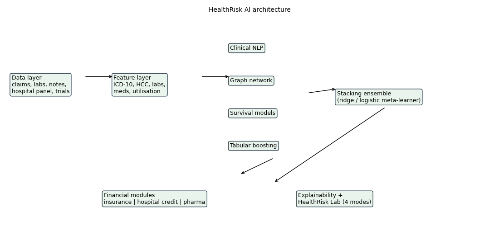

# HealthRisk AI

Healthcare intelligence inside financial risk models: clinical outcome prediction, survival analysis, actuarial pricing and IBNR, hospital credit risk,
pharmaceutical analytics, explainability, and **HealthRisk Lab** (a four-mode, 1000-point simulation game). Plain pandas + scikit-learn + scipy.

> **Read first.** No HealthRisk data was provided, MIMIC-IV needs credentialed access, and the build machine had no internet or PyTorch.
> All results come from a **synthetic health-financial world**. They show the pipeline works, not real-world performance, and many of the brief's
> numeric targets are **missed** (see `docs/report.md`). No ClinicalBERT, GAT, DeepSurv, XGBoost/LightGBM, SHAP, MLflow or DVC; simpler equivalents are used and named.

## Quick start
```
pip install -r requirements.txt
python run_models.py       # about 1 minute: data, features, all models -> results/results.json
python run_sim.py          # HealthRisk Lab AI vs naive, 10-year run -> results/simulation.json
python make_figures.py     # 22 charts + architecture diagram
python make_report.py      # docs/report.md, MODEL_CARDS.md, GAME_DESIGN.md
python tests/run_tests.py  # 32 tests (or: pytest --cov)
python -m simulation.lab   # play the game in a terminal
docker compose up --build  # lab demo + tests + pipeline (never run in the build environment)
```

## Architecture


## Repository map (follows the brief's structure)
| Path | Content |
|---|---|
| `data/acquisition`, `data/processing`, `data/features` | public-data fetchers (untested), synthetic world + quality protocol + logging, clinical features and catalog |
| `models/clinical_nlp`, `graph_network`, `survival`, `tabular`, `ensemble` | NLP, graph propagation, Cox and discrete-time survival, boosting, stacking |
| `financial/insurance`, `credit_risk`, `pharma` | GLM and IBNR, hospital PD and early warning, rNPV and portfolio |
| `simulation` | HealthRisk Lab engine and SEIR module |
| `explainability` | permutation importance, occlusion, PDP, counterfactuals, regulatory matrix |
| `docs`, `reports`, `results`, `configs`, `notebooks`, `tests` | documents, figures, JSON results, config, notebooks, tests |

## Results snapshot (synthetic data)
Mortality AUROC 0.82, readmission 0.75 (stacked ensemble), complication C-index 0.82; cost R2 0.14 (GLM about 0); hospital PD Gini 0.54 but clinical metrics added nothing;
pharma portfolio targets missed; AI opponent beats a naive policy in all four game modes. Details and every miss are in `docs/report.md`.

## Not delivered
Demo video; Sphinx API docs; DVC and MLflow (a JSON run log is used); real data; neural models; SHAP; ESG module; Docker and CI never run.

Private and confidential. IP belongs to Zetheta Algorithms Pvt. Ltd. (see LICENSE).
