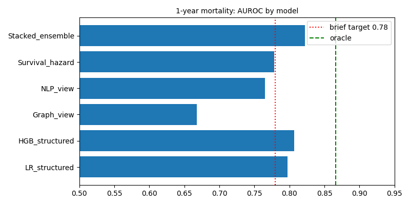
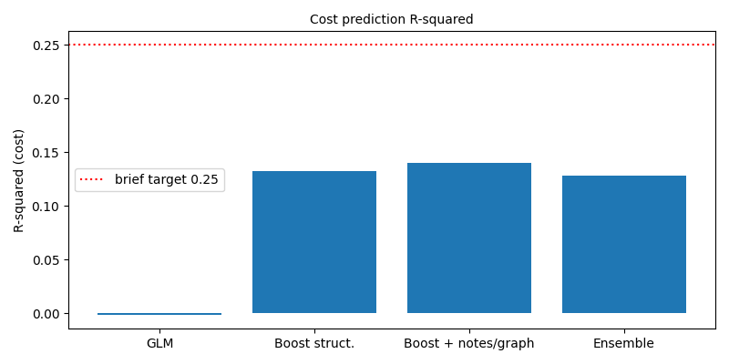
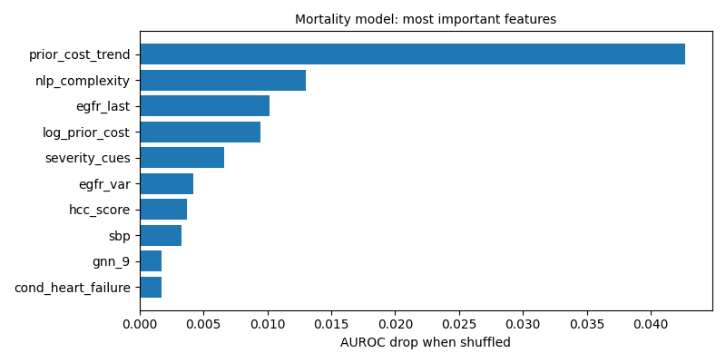
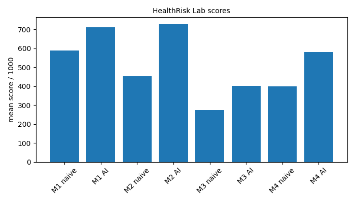

# HealthRisk AI - Technical Report

> **Read first.** No HealthRisk data files were provided, MIMIC-IV needs credentialed access, and the build machine had no internet or PyTorch.
> Every result comes from a **synthetic health-financial world** (`data/processing/synth.py`). Results show that the pipeline works, **not** how it
> would perform on real patients, hospitals or markets. This file is generated by `make_report.py` from `results/*.json`.

## 1. What was built, against the brief
| Brief item | In this repo | Honest status |
|---|---|---|
| Data pipeline with config, validation | `data/processing/synth.py`, `ops.py`, `configs/config.json`, `data/acquisition/acquire.py` | synthetic data; acquisition code untested; JSON config instead of YAML |
| Feature engineering (ICD-10, HCC, labs, meds, utilisation) | `data/features/clinical_features.py`, `docs/feature_catalog.csv` | done |
| Clinical NLP (ClinicalBERT, NER, complexity) | `models/clinical_nlp` TF-IDF + logistic regression, lexicon NER with negation | **no ClinicalBERT** |
| GNN (GAT / HGT) | `models/graph_network` neighbour propagation on comorbidity and drug graphs | **no attention, not a GAT** |
| Survival (Cox, DeepSurv, Dynamic-DeepHit) | `models/survival`: own Cox PH, discrete-time boosting, lab-update comparison | **no neural survival models** |
| XGBoost / LightGBM + tuning | `models/tabular` scikit-learn boosting, random search | not XGBoost / LightGBM |
| Stacking ensemble, time-aware CV | `models/ensemble` | done |
| Insurance module (GLM, enhanced pricing, IBNR, stratification) | `financial/insurance` | done |
| Hospital credit module | `financial/credit_risk` | done |
| Pharma module (monitor, rNPV, patent cliff, optimiser) | `financial/pharma` | done; ClinicalTrials.gov monitor not run |
| HealthRisk Lab | `simulation/lab.py`, `simulation/epi.py` | done: 4 modes, 12 scenarios, 1000-point scoring |
| Explainability | `explainability/explain.py` | occlusion / permutation / PDP / counterfactuals, **not SHAP** |
| MLflow, DVC, Sphinx | `ops.log_run` JSON log | **not used** |
| Tests | `tests/` 32 tests | done |
| Docker, CI | `Dockerfile`, `docker-compose.yml`, `.github/` | **never run** |
| Health-sector ESG module | - | **not built** |
| Demo video | - | **not built** |

## 2. Requirement scoreboard
| Requirement | Target | Achieved | Status | Note |
|---|---|---|---|---|
| Diagnosis classification AUROC | > 0.75 | 1.0 | met | templated notes, inflated |
| Clinical NER F1 | > 0.70 | 0.82 | met | cue-word lexicon, inflated |
| Cost from notes alone, R2 | > 0.15 | 0.03 | NOT met | on ln(1 + cost) |
| Mortality AUROC, graph view alone | > 0.78 | 0.668 | NOT met | relational propagation, not a GAT |
| Readmission AUROC, graph view alone | > 0.72 | 0.613 | NOT met |  |
| Mortality AUROC, stacked ensemble | > 0.78 / > 0.80 | 0.822 | met | 95% CI [0.782, 0.864]; oracle 0.866 |
| Readmission AUROC, stacked ensemble | > 0.72 | 0.746 | met | 95% CI [0.714, 0.784]; oracle 0.791 |
| AUPRC rare event (mortality) | > 0.40 | 0.205 | NOT met | prevalence 0.0264 |
| Brier score (mortality / readmission) | < 0.15 | 0.0233 / 0.1497 | met |  |
| Survival C-index, time to readmission | > 0.70 | 0.658 | NOT met | Cox PH |
| Survival C-index, time to complication | > 0.72 | 0.817 | met | Cox PH with updated labs |
| Ensemble beats best single model: mortality / readmission / cost | all tasks | True / True / False | NOT met | ensemble does not help cost |
| Predictive ratio, enhanced pricing | 0.95 - 1.05 | 0.948 | NOT met |  |
| Cost R2, enhanced vs GLM | > 0.25 | 0.14 vs -0.002 | NOT met | traditional benchmark 0.12-0.15 |
| MAPE individual / cohort | < 15% / < 5% | 123.8% / 9.98% | NOT met | cohort = 200 members |
| Hospital PD Gini / KS | > 0.50 / > 0.30 | 0.544 / 0.448 | met | financial-only scorecard |
| Hospital PD: clinical metrics add value | improvement | 0.766 vs 0.772 | NOT shown | CI of difference [-0.027, 0.013] |
| PSI train vs test (hospital features) | < 0.10 | 0.572 | NOT met | 2020 regime shift |
| Pharma portfolio: Information ratio / Sharpe / drawdown / hit rate | > 0.5 / > 1.0 / < 25% / > 55% | -0.04 / 0.12 / 34.3% / 53.0% | NOT met |  |
| Scenario types / modes / complete 10-year run | >= 10 / 4 / 1 | 12 / 4 / yes | met |  |

## 3. Data and leakage control
* 16,000 synthetic members (index years 2019-2022) with labs, medications, utilisation, notes and a 60-drug interaction graph; 320 hospitals x 40 quarters; a 10x10 claims triangle; 1,400 trials; 20 stocks x 120 months.
* **Time split:** train index years 2019-2020 (8,080 members), **embargo 2021** (3,907), test 2022 (4,013). Hospitals: train quarters to 2019Q4, embargo 2020, test observations 2021Q1-2023Q4 with labels to 2024Q4. Trials: train starts up to 2012, test 2016 onward. Graph embeddings and the notes model are fitted on training rows only; the notes score for training rows is out-of-fold; the stack uses time-aware folds.
* **Signal strength is my design choice.** A perfect model that knows the hidden true probabilities would reach AUROC 0.866 (mortality) and 0.791 (readmission); the real models reach 0.822 and 0.746. My first, weaker version had ceilings of 0.79 and 0.72, which made the brief's targets almost unreachable, so I raised the signal. That is a data choice, not a finding.
* Six-stage data-quality protocol: code-vs-note agreement 0.728, consistency violations {'bph_in_females': 0, 'negative_cost': 0, 'mortality_without_age': 0, 'hba1c_without_diabetes': 0}, ICD-10 conformity 1.0, duplicates 0. Real data would show far more problems; missing-not-at-random labs are reproduced.

## 4. Results
### 4.1 Clinical NLP
Diagnosis macro AUROC 1.0 and NER F1 0.82 are **inflated** by template notes. The honest test is cost from notes alone: R2 0.03 (target 0.15), so the notes add little beyond structured fields except through the severity-cue count.

### 4.2 Prediction tasks (test = index year 2022)
**1-year mortality** (106 deaths in test):
| model | AUROC | 95% CI | AUPRC | Brier |
|---|---|---|---|---|
| LR structured | 0.797 | [0.751, 0.844] | 0.202 | 0.0233 |
| HGB structured | 0.807 | [0.76, 0.855] | 0.186 | 0.0236 |
| Graph view | 0.668 | [0.615, 0.722] | 0.063 | 0.0254 |
| NLP view | 0.765 | [0.729, 0.804] | 0.074 | 0.0251 |
| Survival hazard | 0.778 | [0.725, 0.827] | 0.1 | 0.0257 |
| Stacked ensemble | 0.822 | [0.782, 0.864] | 0.205 | 0.0233 |

**30-day readmission** (admitted members, 276 events):
| model | AUROC | 95% CI | AUPRC | Brier |
|---|---|---|---|---|
| LR structured | 0.731 | [0.7, 0.771] | 0.463 | 0.1526 |
| HGB structured | 0.725 | [0.693, 0.764] | 0.446 | 0.1538 |
| Graph view | 0.613 | [0.578, 0.653] | 0.33 | 0.1687 |
| NLP view | 0.679 | [0.648, 0.714] | 0.333 | 0.1625 |
| Survival hazard | 0.73 | [0.695, 0.764] | 0.45 | 0.1532 |
| Stacked ensemble | 0.746 | [0.714, 0.784] | 0.468 | 0.1497 |

* The stacked ensemble is best on both tasks, but the gain over the best single model is small and the 95% intervals overlap. The graph view alone is weak (0.668 / 0.613); it only helps as one ensemble member. Calibration-in-the-large (mortality): 1.038.

### 4.3 Survival models
| Task | Model | C-index | Time-dependent AUROC |
|---|---|---|---|
| Time to readmission (1227 test, 539 events) | Cox PH | 0.658 | {'90': 0.698, '180': 0.695} days |
| | Discrete-time boosting | 0.654 | {'90': 0.695, '180': 0.689} days |
| Complication (diabetics), early labs | Cox PH | 0.801 | {'3': 0.916, '6': 0.895, '12': 0.864, '24': 0.853} months |
| Complication, **updated labs** | Cox PH | 0.817 | {'3': 0.932, '6': 0.915, '12': 0.877, '24': 0.867} months |
| Complication, updated labs | Discrete-time boosting | 0.81 | {'3': 0.921, '6': 0.901, '12': 0.869, '24': 0.866} months |
| Covenant breach (hospitals) | Cox PH | 0.713 | {'16': 0.778} quarters |

Readmission timing misses the 0.70 target; complication prediction beats 0.72, and updating the labs raises the C-index (static 0.801 to updated 0.817), which is the idea behind Dynamic-DeepHit. The boosted discrete-time model does not beat plain Cox.

### 4.4 Insurance actuarial module
| model | predictive_ratio_all | predictive_ratio_top5pct | R2 | MAPE_individual_pct_positive_cost | MAPE_cohort200_pct | worst_subgroup_deviation_pct |
|---|---|---|---|---|---|---|
| GLM baseline (rating factors, Tweedie 1.5) | 0.944 | 0.156 | -0.002 | 173.6 | 10.26 | 19.3 |
| Boosting, structured clinical features | 0.951 | 0.246 | 0.132 | 128.7 | 9.7 | 12.1 |
| Boosting, + notes and graph features (HealthRisk AI enhanced) | 0.948 | 0.248 | 0.14 | 123.8 | 9.98 | 12.1 |
| Stacked ensemble (ridge meta-learner) | 0.933 | 0.228 | 0.128 | 129.1 | 10.46 | 13.4 |

* Clinical features lift R2 from -0.002 (a rating-factor GLM explains nothing here) to 0.14; the brief's 0.25 is **not** reached. Cohort MAPE is 9.98% (target 5%): a few very large random claims dominate cohorts of 200.
* Top 5% of members: predictive ratio only 0.248; catastrophic claims are mostly random here, so the tail is under-predicted.
* Stratification: top decile costs 5.95x the bottom decile (GLM 1.08x); AUROC for the costliest 5% 0.748 (GLM 0.529). Loss-ratio spread across predicted-risk deciles (cross-subsidy): GLM 0.347, enhanced 0.257.
* **IBNR** (true ultimates are known; 2020-2021 emerge more slowly than history):
| method | total_ibnr_est | total_ibnr_true | total_error_pct | mean_abs_dev_recent_years_pct | ultimate_MAPE_pct |
|---|---|---|---|---|---|
| chain_ladder | 673.8 | 653.8 | 3.06 | 15.3 | 1.21 |
| bornhuetter_ferguson | 667.7 | 653.8 | 2.12 | 13.8 | 0.99 |
| emergence_adjusted_chain_ladder | 666.7 | 653.8 | 1.98 | 10.3 | 1.05 |

### 4.5 Hospital credit risk
| model | auroc | gini | ks | brier |
|---|---|---|---|---|
| traditional_scorecard_LR | 0.772 | 0.544 | 0.448 | 0.0607 |
| enhanced_scorecard_LR | 0.766 | 0.532 | 0.394 | 0.0608 |
| traditional_HGB | 0.729 | 0.458 | 0.373 | 0.0649 |
| enhanced_HGB | 0.74 | 0.479 | 0.351 | 0.0639 |

Train 5,694 / test 2,178 hospital-quarters (247 / 161 events).
* **Clinical quality metrics did not improve the 4-quarter PD** (AUROC difference CI [-0.027, 0.013] includes zero). In this generator distress is persistent, so financial ratios already carry the information. That contradicts the brief's premise; it is a result about this data.
* Early warning on 169 breached hospitals: clinical flags find 68% (median lead 7.0 quarters, false-alarm share 18%); financial flags find 72% (median lead 10.0, false-alarm share 29%).
* Bond spread: 147.0 bps per doubling of PD (R2 0.355).
* **Stability:** PSI train vs test {'op_margin': 0.572, 'dscr': 0.471, 'days_cash': 0.509, 'readmit_rate': 0.407, 'hcahps': 0.262, 'ed_boarding': 0.382}, far above 0.25; the 2020 shock moved the whole distribution, so a pre-2020 model needs recalibration.
* Worked example (one test hospital): {'PD_traditional': 0.0215, 'PD_enhanced': 0.038, 'pd_change_pct': 76.6, 'rating_traditional': 'BBB', 'rating_enhanced': 'BBB-'}.

### 4.6 Pharmaceutical analytics
* Phase-success model AUROC 0.674 vs 0.616 for the brief's generic phase rates (675 train / 446 test trials).
| company | market_cap_B | rNPV_mean_B | P10 | P90 | pipeline_value_to_mcap | top_drug_share |
|---|---|---|---|---|---|---|
| Alpha Oncology | 5.2 | 2.57 | 0.0 | 5.8 | 0.5 | 0.56 |
| Beta Immunology | 4.5 | 1.74 | 0.0 | 3.99 | 0.39 | 0.69 |
| Gamma Rare Disease | 2.0 | 0.58 | 0.0 | 2.38 | 0.29 | 0.75 |
| Delta CNS | 7.5 | 3.3 | 0.0 | 6.75 | 0.44 | 0.56 |
| Epsilon Vaccines | 3.0 | 1.27 | 0.0 | 3.67 | 0.42 | 0.72 |

* rNPV: model-based probabilities, 10% discount, Monte Carlo over success and peak sales, 80% post-patent erosion; companies are synthetic. Patent-cliff example ($2.5B drug, expiry in 7 years): 5.0B lost in the 3 years after expiry.
* Mean-variance portfolio (long-only, 15% cap, monthly): with signal {'sharpe': 0.12, 'information_ratio': -0.04, 'max_drawdown_pct': -34.3, 'hit_rate_months_beating_benchmark_pct': 53.0, 'annual_return_pct': 1.8}; without {'sharpe': 0.14, 'information_ratio': -0.0, 'max_drawdown_pct': -31.9, 'hit_rate_months_beating_benchmark_pct': 43.4, 'annual_return_pct': 2.1}. **No portfolio target is met** and the signal does not help: a small alpha (assumed IC 0.06) was built into the synthetic returns and is too weak to detect in 7 years of monthly data.

### 4.7 Explainability
Top mortality drivers (permutation importance): {'prior_cost_trend': 0.0427, 'nlp_complexity': 0.013, 'egfr_last': 0.0102, 'log_prior_cost': 0.0095, 'severity_cues': 0.0066, 'egfr_var': 0.0042, 'hcc_score': 0.0037, 'sbp': 0.0033, 'gnn_9': 0.0017, 'cond_heart_failure': 0.0017}. Counterfactuals for three high-risk readmission cases reached the target in 0 of 3 cases (clinically actionable changes only). Premium breakdown, local explanations and an HbA1c partial-dependence curve are in `results/results.json`; the regulatory mapping is `docs/regulatory_matrix.csv`.

### 4.8 Epidemiology link
SEIR with R0 = 2.5 (incubation 5.5 days, infectious 6 days): attack rate 89%, peak at day 116, doubling time 6.9 days. For a 50,000-member book, 2,500 members need treatment (375 severe), about $31.3M of incremental claims (unit costs are the brief's assumptions).

### 4.9 HealthRisk Lab
Mean score over 20 seeds: Mode 1 Actuarial (20 quarters) naive 587 / AI 710; Mode 2 Hospital Credit (40) 451 / 727; Mode 3 Pharma (20) 274 / 402; Mode 4 Integrated (40) 399 / 579. The AI beats the naive policy in 100% of Mode 4 games. A complete 10-year Master-mode run: 612 points (HealthRisk Analyst). Pandemic replay: AI 574 vs naive 370. The AI opponent is a rule set using the same risk signals with less noise, **not** the trained models; the scoring formulas are my own.

## 5. Limitations
1. Synthetic data only; nothing transfers to real populations.
2. No ClinicalBERT, GAT/HGT, DeepSurv/Dynamic-DeepHit, XGBoost, LightGBM, SHAP, MLflow, DVC; simpler equivalents are named as such. No ESG module and no demo video.
3. NLP scores are inflated by template text.
4. Many numeric targets are missed (see scoreboard): the whole pharma portfolio set, insurance R2 and tail accuracy, readmission C-index, PSI stability.
5. Hospital clinical metrics showed no incremental value here, the opposite of the brief's premise.
6. Few test events (e.g. 106 deaths) give wide confidence intervals.
7. Docker, CI and the acquisition code were never run.

## 6. Reproduce
`pip install -r requirements.txt`, then `python run_models.py && python run_sim.py && python make_figures.py && python make_report.py`. Tests: `python tests/run_tests.py` (32 tests, estimated line coverage about 98% from `coverage_estimate.py`; use `pytest --cov` for the official number).

## 7. References
1. Cox, D. R. (1972). Regression models and life-tables. Journal of the Royal Statistical Society B 34.
2. Katzman, J. L. et al. (2018). DeepSurv. BMC Medical Research Methodology 18.
3. Lee, C., Zame, W., Yoon, J. and van der Schaar, M. (2018). DeepHit. AAAI.
4. Lee, C., Yoon, J. and van der Schaar, M. (2020). Dynamic-DeepHit. IEEE Transactions on Biomedical Engineering 67.
5. Velickovic, P. et al. (2018). Graph attention networks. ICLR.
6. Hu, Z., Dong, Y., Wang, K. and Sun, Y. (2020). Heterogeneous graph transformer. WWW.
7. Alsentzer, E. et al. (2019). Publicly available clinical BERT embeddings. Clinical NLP Workshop.
8. Johnson, A. E. W. et al. (2023). MIMIC-IV. Scientific Data 10.
9. Chen, T. and Guestrin, C. (2016). XGBoost. KDD.
10. Ke, G. et al. (2017). LightGBM. NeurIPS.
11. Lundberg, S. M. and Lee, S.-I. (2017). A unified approach to interpreting model predictions. NeurIPS.
12. Wolpert, D. H. (1992). Stacked generalization. Neural Networks 5.
13. Mack, T. (1993). Distribution-free calculation of the standard error of chain ladder reserve estimates. ASTIN Bulletin 23.
14. Bornhuetter, R. L. and Ferguson, R. E. (1972). The actuary and IBNR. Proceedings of the Casualty Actuarial Society 59.
15. Pope, G. C. et al. (2011). Evolution of the CMS-HCC risk adjustment model. Health Care Financing Review.
16. Kermack, W. O. and McKendrick, A. G. (1927). A contribution to the mathematical theory of epidemics. Proceedings of the Royal Society A 115.
17. Vickers, A. J. and Elkin, E. B. (2006). Decision curve analysis. Medical Decision Making 26.
18. Mitchell, M. et al. (2019). Model cards for model reporting. FAT*.
19. Wachter, S., Mittelstadt, B. and Russell, C. (2018). Counterfactual explanations without opening the black box. Harvard Journal of Law and Technology 31.
20. Hay, M. et al. (2014). Clinical development success rates for investigational drugs. Nature Biotechnology 32.
21. Markowitz, H. (1952). Portfolio selection. Journal of Finance 7.
22. Harrell, F. E., Lee, K. L. and Mark, D. B. (1996). Multivariable prognostic models. Statistics in Medicine 15.
23. Brier, G. W. (1950). Verification of forecasts expressed in terms of probability. Monthly Weather Review 78.
24. Pedregosa, F. et al. (2011). Scikit-learn. JMLR 12.
25. Charlson, M. E. et al. (1987). A new method of classifying prognostic comorbidity. Journal of Chronic Diseases 40.
26. Hosmer, D. W. and Lemeshow, S. (2000). Applied Logistic Regression, 2nd ed. Wiley.
*(Please verify every reference before submitting; details were written from memory.)*
